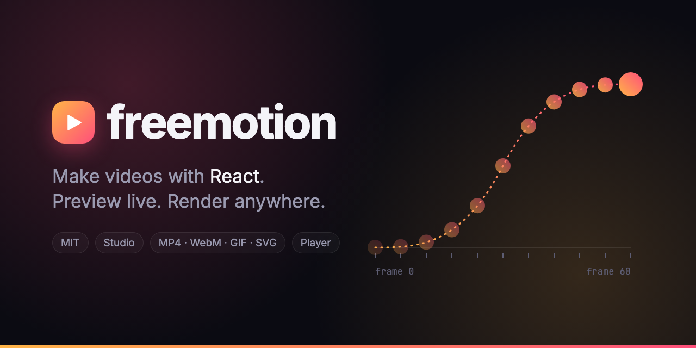
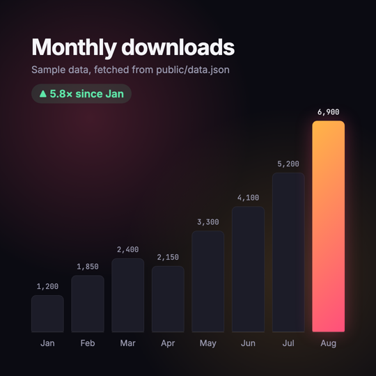
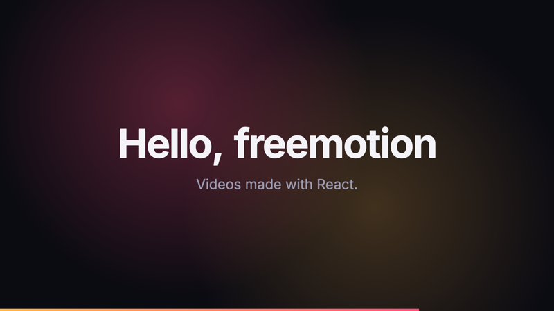
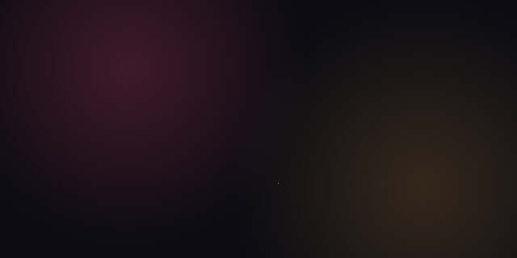
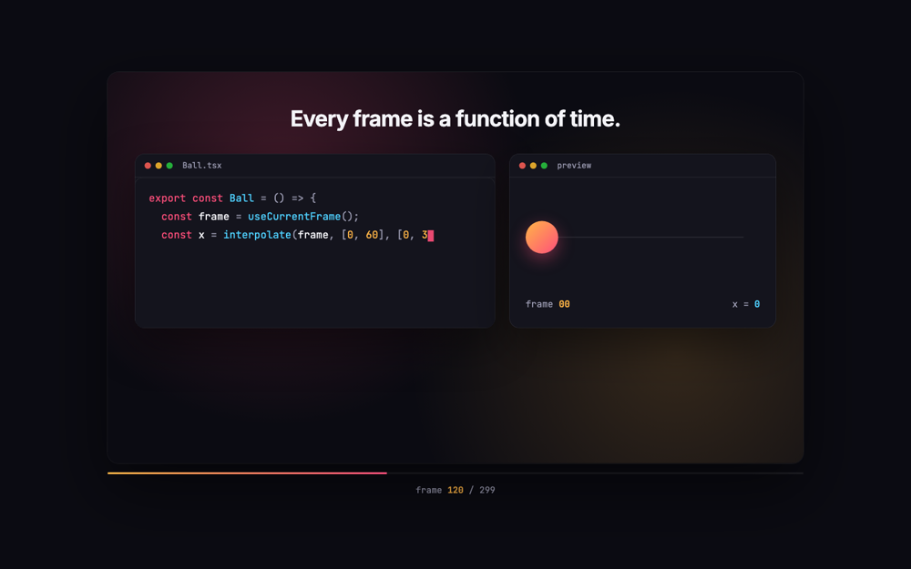

<p align="center">
  
</p>

<p align="center">
  Example videos and a scroll-driven page made with <a href="https://github.com/douglasjunior/freemotion"><b>freemotion</b></a>, the MIT-licensed way to make videos with React.
  Every picture on this page, including the banner above, is a freemotion composition from this repository.
</p>

<p align="center">
  <a href="LICENSE"></a>
  <a href="https://github.com/douglasjunior/freemotion"></a>
</p>

---

## 🚀 Run it

```bash
git clone https://github.com/douglasjunior/freemotion-examples.git
cd freemotion-examples
npm install
npm run studio        # browse every composition with hot reload
npm run render        # render all of them to out/
npm run web           # the scroll-driven page
```

You only need **Node.js 20.19+**. ffmpeg comes from the `ffmpeg-static` dependency and the headless Chromium is downloaded on the first render.

## 🎬 The examples

### Showcase · `src/showcase`


The video at the top of the freemotion README. Scenes play one after the other with `<Series>`, the code is revealed character by character from the frame number, and the preview on the right runs the very `interpolate()` call being typed.

```bash
npx freemotion render Showcase                 # out/Showcase.mp4
```

### Data story · `src/data-story`



A square bar chart for social media. The data comes from [`public/data.json`](public/data.json) through `fetch()`, and `delayRender()` holds the renderer until it arrives, so no frame is captured with an empty chart. Bars grow with staggered springs and the labels count up with `interpolate()`.

```bash
npx freemotion render DataStory --format gif
```

### Hello World · `src/hello`



The project that `npx freemotion init` creates. Its title and subtitle are props, so you can render variations without touching the code:

```bash
npx freemotion render HelloWorld --props '{"title":"Launch day","subtitle":"Version 2 is here."}'
```

### Banner · `src/banner`



The banner of this README and of freemotion's, as a three-second intro. A ball travels an ease-in-out curve and leaves a copy of itself at evenly spaced frames, while an SVG clip path reveals the dotted curve behind it. Everything settles by the last frame, which is the still image at the top of this page.

```bash
npx freemotion render Banner                          # out/Banner.mp4
npx freemotion render Banner --frame 95 -o banner.png # the README still
```

## 🌐 Scroll-driven page · `web/`

<a href="https://douglasjunior.work/freemotion-examples/"></a>

**Live at [douglasjunior.work/freemotion-examples](https://douglasjunior.work/freemotion-examples/)**, published to GitHub Pages by the [`pages` workflow](.github/workflows/pages.yml) on every push to `main`.

A regular Vite app that plays the Showcase composition with freemotion's [`<ScrollPlayer>`](web/main.tsx). The player sticks to the viewport inside a section five screens tall, and the scroll position inside the section picks the frame. Scroll down and the video moves forward; scroll up and it rewinds. When the section ends, the video scrolls away with the page.

```bash
npm run web           # dev server
npm run web:build     # static build in web/dist
```

## 🔧 Scripts

| Script | What it does |
|---|---|
| `npm run studio` | Opens the freemotion studio with every composition |
| `npm run render` | Renders every composition to `out/` |
| `npm run readme-assets` | Regenerates the banner (PNG and GIF) and the showcase GIF in `assets/`, straight from `freemotion render` |
| `npm run web` / `npm run web:build` | Runs or builds the scroll-driven page |
| `npm run ts` / `npm run lint` | Type checks and lints |

## 📄 License

[MIT](LICENSE) © Douglas Nassif Roma Junior
